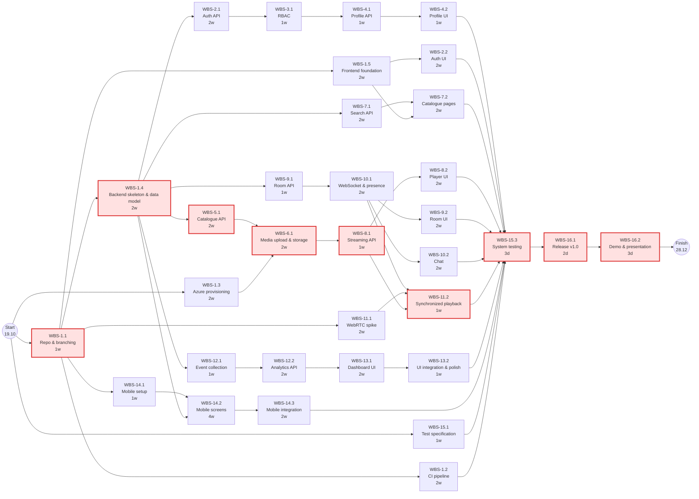
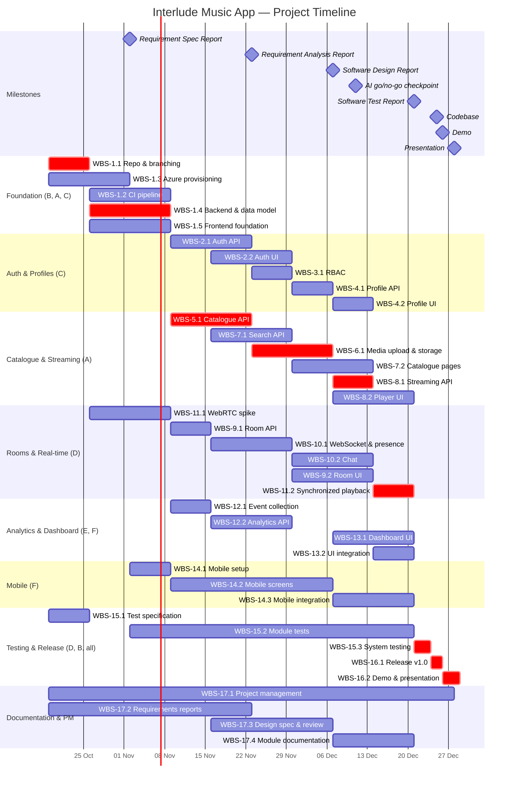

# Software Engineering Project Plan

## Cover Page

| Field | Details |
| :---- | :---- |
| **Course** | BLG 411E Software Engineering |
| **Report name** | Project Plan |
| **Project title** | Interlude Music App |
| **Group name / number** | Nova |
| **Group members** | Şevval Tüfekçi 150230079, Lara Doğan 150250706, Sudenaz Hasret  150230072, M. Kağan Temur 150230093,  Efe Arda Demir 150240078,  Ahmet Taha Angın 150230034 |
| **Instructor** | Ayşe Tosun Kühn |
| **Submission date** | 2026-10-24 |
| **Document version** | 1.0 |

---

## 1\. Introduction

### 1.1 Scope

**Project overview:**  
Interlude is a social music platform in the music-streaming and social-listening domain. Listeners lack a simple way to discover music and listen together with others in real time, and independent musicians lack an easy way to see how their music is being listened to. Interlude combines a music catalogue and player, shared listening rooms with real-time presence and chat, and a musician analytics dashboard in one web application, with a native mobile app offering selected core features. Intended users are listeners, communities of music listeners, and independent musicians.

**In scope:**

- User registration, login, authentication, authorization and role-based access control (listener, musician, admin)  
- User and musician profiles  
- Music catalogue with song and album metadata  
- Media upload and storage integration (Microsoft Azure)  
- Search and browsing of songs/albums, and a basic music player/streaming interface  
- Shared listening rooms with synchronized playback and room participation  
- Real-time participant presence and text chat over WebSocket  
- Collection of basic listening events and analytics  
- Musician dashboard with basic statistics (play counts, popular tracks)  
- Frontend pages for authentication, profiles, catalogue, player, listening rooms, chat and musician dashboard  
- Native mobile application with selected core features  
- Automated tests and coverage reporting, technical documentation, CI/CD, and a demonstrable deployment on Azure  
- Requirements management, issue tracking and release management

**Optional scope:**

- A small AI-powered chatbot / music discovery assistant using an existing AI API, considered only after the core requirements are complete.

**Out of scope:**

- A production grade global music-streaming service or commercial licensing agreements  
- Payment processing, subscriptions, advertising, royalties or artist payouts  
- Advanced recommendation models, model training or a full AI recommendation engine  
- Guaranteed production-scale availability, large-scale load handling or enterprise-grade security certification  
- Uploading or distributing copyrighted music without appropriate permission

**Assumptions and constraints:**

- **Time:** Development runs from 30.10.2026 to the codebase deadline 25.12.2026 (approx. 8 weeks), followed by the demo (26.12.2026) and presentation (28.12.2026). Course reports (Requirement Specification 02.11, Requirement Analysis 23.11, Design 07.12, Test 21.12) are produced in parallel and consume part of the team's time.  
- **Team:** Six students, each available on average \~0.3-0.4 FTE (approx. 12-16 h/week) alongside other courses, total capacity approx. 20 human weeks.  
- **Technology:** Django \+ Django ORM (REST), WebSocket for chat/presence, WebRTC for low-latency room audio, React \+ TypeScript frontend, Microsoft Azure for hosting, deployment and file storage. The mobile framework is selected in WBS-14.1 (a React-based option such as React Native).  
- **AI tools:** Claude Code and ChatGPT are used as development assistants; estimates already assume this support, and all AI-generated code is reviewed via pull requests.  
- **Budget:** Cloud costs must stay within free/student Azure credits. Claude and ChatGPT Pro subscriptions.   
- **Content:** Only royalty-free, self-produced or explicitly licensed audio is used for testing and the demo.

### 1.2 Deliverables

| Deliverable ID | Deliverable name | Description / contents | Acceptance criterion |
| :---- | :---- | :---- | :---- |
| D-01 | Authentication & User Management Module | Registration, login, auth, role-based access control, user and musician profiles (backend \+ web UI) | Users can register, log in and edit profiles; role-restricted endpoints reject unauthorized roles; module tests pass in CI |
| D-02 | Music Catalogue & Streaming Module | Song/album models and metadata, media upload to Azure storage, search/browse APIs and pages, streaming API and music player | A musician can upload a track with metadata; a listener can find it via search and play it in the player; module tests pass |
| D-03 | Listening Rooms & Real-time Communication Module | Room creation/join/leave, WebSocket presence and chat, WebRTC synchronized playback, room/chat UI | Two or more users in one room see each other's presence, exchange chat messages and hear the same track in sync |
| D-04 | Analytics & Musician Dashboard | Listening-event collection, analytics APIs/metrics, dashboard with charts | Plays are recorded; a musician sees play counts and popular tracks for their own music only |
| D-05 | Web Frontend Application | React/TypeScript app: shared layout and routing plus all feature pages | All core pages are reachable via routing and work against the deployed backend |
| D-06 | Native Mobile Application | Mobile app with selected core features integrated with the backend API | App runs on the chosen platform and completes login → search → play against the deployed API |
| D-07 | Infrastructure, CI/CD & Deployment | GitHub repository with branch protection, CI pipeline, Azure environment, released and deployed version | Every merge to main runs CI, tagged release v1.0 is deployed and reachable for the demo |
| D-08 | Test Suite & Coverage Report | Test specification, unit/integration/system tests, coverage reports | All tests pass in CI; backend coverage ≥ 70%; test results feed the Software Test Report |
| D-09 | Documentation | Requirements, design and technical/module documentation, project-management records | Documents are reviewed for consistency and match the delivered system |
| D-10 *(optional)* | AI Music-Discovery Assistant | Small chatbot using an existing AI API, with documented purpose, limitations, error types and privacy review | Only delivered if the go/no-go checkpoint approves it. |

### 1.3 Functional Requirements / Tasks

| Task ID | Functional requirement / task | Description | Related deliverable ID(s) |
| :---- | :---- | :---- | :---- |
| T-01 | Project infrastructure & foundation | Repository, branch strategy, CI pipeline, Azure environment, backend skeleton/data model and frontend layout/routing | D-07, D-05 |
| T-02 | Registration, login & authentication | Users register and log in, sessions/tokens authenticate API and WebSocket requests | D-01, D-05 |
| T-03 | Role-based access control | Listener, musician and admin roles restrict access to features and data | D-01 |
| T-04 | User & musician profiles | Users view and edit profiles, musicians have public artist profiles | D-01, D-05 |
| T-05 | Music catalogue & metadata | Create, read, update and delete songs and albums with metadata | D-02 |
| T-06 | Media upload & storage | Musicians upload audio/cover files to Azure storage with validation | D-02, D-07 |
| T-07 | Search & browsing | Listeners search and browse songs/albums, homepage and catalogue pages | D-02, D-05 |
| T-08 | Music player & streaming | Tracks are streamed from storage and played in a player UI | D-02, D-05 |
| T-09 | Listening rooms | Users create, join and leave shared listening rooms | D-03, D-05 |
| T-10 | Real-time presence & chat | Room participants see who is present and chat in real time via WebSocket | D-03, D-05 |
| T-11 | Synchronized room playback | Participants of a room hear the same track at the same position (WebRTC) | D-03 |
| T-12 | Listening-event collection & analytics | Play events are recorded and aggregated into metrics | D-04 |
| T-13 | Musician dashboard | Musicians see statistics and charts for their music | D-04, D-05 |
| T-14 | Native mobile application | Mobile client with selected core features integrated with the backend | D-06 |
| T-15 | Testing & coverage | Test-first specification, module tests, system integration tests, coverage tracking | D-08 |
| T-16 | Deployment, release & demo | Release v1.0 deployed on Azure, demo and presentation prepared | D-07 |
| T-17 | Documentation & project management | Planning, meetings, risk tracking, requirements /design/technical documentation | D-09 |
| T-18 *(optional)* | AI music discovery assistant | Small chatbot using an existing AI API, if time permits | D-10 |

### 1.4 Non-functional Issues

| Quality attribute | Requirement / concern | How it will be assessed |
| :---- | :---- | :---- |
| Security | Passwords hashed with Argon2 password hashing; authenticated APIs and WebSockets, RBAC enforced server-side, HTTPS in deployment, upload type/size validation, media served via time-limited storage URLs, secrets kept out of the repository | Unit tests for every permission rule, secret scanning in CI |
| Performance | Catalogue/search API responses \< 500 ms under demo load, chat message delivery \< 300 ms, playback drift between room participants \< 500 ms, playback starts \< 2 s | Timed API tests; simple load script with 20 simulated users; measured drift in a multi-client room test |
| Usability | Consistent layout across pages, responsive web UI, core flows (log in → find a song → play / join a room), clear error messages | Short usability walkthrough with 5 peer testers, checklist review of each page |
| Reliability | WebSocket clients reconnect automatically, graceful error handling for failed uploads/streams, main branch always deployable | Integration tests for reconnect and error paths, CI must be green before merge |
| Maintainability | PR-based code review, formatting, documented modules | CI lint checks, backend coverage ≥ 70% reported in CI |
| Privacy | Analytics shown to musicians only as aggregates, no personal data sent to external AI APIs without review | Review of analytics API responses, privacy review in the optional AI evaluation |

---

## 2\. Project Plan \- Work Breakdown Structure (WBS)

Size scale: **T \= Tiny · S \= Small · M \= Medium · L \= Large · XL \= Extra-large**

| WBS activity ID | Parent task ID | Activity / subtask | Description / completion condition | Size (T/S/M/L/XL) |
| :---- | :---- | :---- | :---- | :---- |
| WBS-1.1 | T-01 | Repository & branch strategy | Repo created, branch protection rules, PR template, GitHub Projects board set up | S |
| WBS-1.2 | T-01 | CI pipeline | Pipeline runs lint, backend and frontend tests and coverage on every PR | S |
| WBS-1.3 | T-01 | Azure environment provisioning | App hosting, database and Blob Storage created, staging deploy works | S |
| WBS-1.4 | T-01 | Backend skeleton & core data model | Django project structure, apps, core models (User, Song, Album, Room, ListeningEvent) and migrations merged | M |
| WBS-1.5 | T-01 | Frontend foundation | React/TS project with shared layout, routing and API client merged | S |
| WBS-2.1 | T-02 | Authentication API | Register/login/logout endpoints with token/session auth, tests pass | M |
| WBS-2.2 | T-02 | Login & registration UI | Login and registration pages connected to the API | S |
| WBS-3.1 | T-03 | Role & permission enforcement | Listener/musician/admin roles applied to all protected endpoints, permission tests pass | S |
| WBS-4.1 | T-04 | Profile APIs | User and musician profile endpoints (view/edit) | S |
| WBS-4.2 | T-04 | Profile UI | Profile view/edit pages for users and musicians | S |
| WBS-5.1 | T-05 | Catalogue & metadata API | Song/album CRUD with metadata, validation and tests | M |
| WBS-6.1 | T-06 | Media upload & Azure storage integration | Audio and cover uploads stored in Blob Storage with validation | M |
| WBS-7.1 | T-07 | Search & listing API | Search/filter/paginate songs and albums | S |
| WBS-7.2 | T-07 | Homepage, catalogue & search pages | Pages display and search the catalogue | M |
| WBS-8.1 | T-08 | Streaming API | Tracks streamed from storage (range requests / time-limited URLs) | S |
| WBS-8.2 | T-08 | Music player UI | Player with play/pause/seek/queue integrated with the streaming API | M |
| WBS-9.1 | T-09 | Room model & REST API | Create/join/leave/list rooms | S |
| WBS-9.2 | T-09 | Room UI | Room list, room page and controls | M |
| WBS-10.1 | T-10 | WebSocket infrastructure & presence | Authenticated WebSocket connections, join/leave presence broadcast | M |
| WBS-10.2 | T-10 | Chat backend & UI | Real-time room chat with message persistence and UI | M |
| WBS-11.1 | T-11 | WebRTC technical spike | Prototype proves low-latency shared audio between two clients; decision recorded | M |
| WBS-11.2 | T-11 | Synchronized playback integration | Room host controls playback; all participants stay in sync (\< 500 ms drift) | L |
| WBS-12.1 | T-12 | Listening-event collection | Play/skip/complete events recorded from the player | S |
| WBS-12.2 | T-12 | Analytics API & metrics | Endpoints for play counts, popular tracks and agreed statistics | M |
| WBS-13.1 | T-13 | Dashboard UI & charts | Musician dashboard with charting library visualizations | M |
| WBS-13.2 | T-13 | Frontend integration & UI polish | Consistent styling, navigation and integration across all pages | M |
| WBS-14.1 | T-14 | Mobile framework selection & setup | Framework/platform chosen and documented, project builds and runs | S |
| WBS-14.2 | T-14 | Mobile core screens | Login, browse/search and player screens | L |
| WBS-14.3 | T-14 | Mobile API integration & testing | Screens work against the deployed backend, tested on device/emulator | M |
| WBS-15.1 | T-15 | Test specification & test-first plan | Test plan and test cases per module agreed before implementation | S |
| WBS-15.2 | T-15 | Module unit/integration tests | Each owner writes tests for their module, coverage tracked in CI | L |
| WBS-15.3 | T-15 | System integration & regression testing | End-to-end scenarios pass on staging, final coverage report produced | M |
| WBS-16.1 | T-16 | Production deployment & release v1.0 | Tagged release deployed to Azure and verified | T |
| WBS-16.2 | T-16 | Demo & presentation preparation | Demo script, demo data and presentation ready | S |
| WBS-17.1 | T-17 | Project management | Weekly meetings, board upkeep, risk tracking throughout | M |
| WBS-17.2 | T-17 | Requirements specification & analysis | Requirement Specification and Analysis reports, customer notes | M |
| WBS-17.3 | T-17 | Design specification & documentation review | Design report coordinated and reviewed for consistency | M |
| WBS-17.4 | T-17 | Module & technical documentation | Each module documented (API, setup, usage) | S |
| WBS-18.1 *(optional)* | T-18 | AI assistant evaluation & prototype | Use-case, cost, privacy and risk review, small prototype if approved | M |

**WBS decomposition notes:**

- Activities were split along the module ownership defined in the charter, so each activity has one clear lead.  
- WBS-1.4 defines the shared data model up front because every backend module depends on it.  
- UI activities may start against agreed API contracts and mocked responses, then integrate once the real endpoint is merged.  
- Testing is split into a test-first specification (WBS-15.1), continuous module testing by every owner (WBS-15.2), and a final system test (WBS-15.3).  
- WBS-18.1 is optional and excluded from the core estimate and schedule.

>   
> **Course guideline note:** User stories for these subtasks will be written in the separate requirements document; this project plan defines and sizes the subtasks.

---

## 3\. Estimates

Size-to-effort conversion: **T \= 0.25 · S \= 0.5 · M \= 1 · L \= 2 · XL \= 3 human-weeks**

| WBS activity ID | Size | Estimated effort (man-weeks) | Basis / assumptions |
| :---- | :---- | :---- | :---- |
| WBS-1.1 | S | 0.5 | Standard GitHub setup; team has used GitHub before |
| WBS-1.2 | S | 0.5 | Uses GitHub Actions templates |
| WBS-1.3 | S | 0.5 | Managed Azure services; first-time Azure setup adds some learning |
| WBS-1.4 | M | 1 | Several apps and models, requires team agreement on schema |
| WBS-1.5 | S | 0.5 | Standard React/TS scaffolding with router |
| WBS-2.1 | M | 1 | Django auth reduces work, token handling for REST and WebSocket adds some |
| WBS-2.2 | S | 0.5 | Two forms with validation |
| WBS-3.1 | S | 0.5 | Django permission classes / groups |
| WBS-4.1 | S | 0.5 | Simple CRUD endpoints |
| WBS-4.2 | S | 0.5 | Profile view/edit pages |
| WBS-5.1 | M | 1 | Two related entities with metadata and validation |
| WBS-6.1 | M | 1 | Azure Blob SDK integration, file validation |
| WBS-7.1 | S | 0.5 | ORM filtering and pagination |
| WBS-7.2 | M | 1 | Three pages with search and listing states |
| WBS-8.1 | S | 0.5 | Range requests / time-limited storage URLs |
| WBS-8.2 | M | 1 | Player state, controls and queue |
| WBS-9.1 | S | 0.5 | Simple CRUD |
| WBS-9.2 | M | 1 | Room list and live room page |
| WBS-10.1 | M | 1 | New technology for the team (WebSocket server, auth on connect) |
| WBS-10.2 | M | 1 | Builds on WBS-10.1 |
| WBS-11.1 | M | 1 | Research heavy spike |
| WBS-11.2 | L | 2 | Hardest technical feature, synchronization and edge cases |
| WBS-12.1 | S | 0.5 | Event model already in WBS-1.4 |
| WBS-12.2 | M | 1 | Aggregation queries and agreed statistical analysis |
| WBS-13.1 | M | 1 | Charting library integration |
| WBS-13.2 | M | 1 | Cross page consistency work |
| WBS-14.1 | S | 0.5 | Framework comparison and setup |
| WBS-14.2 | L | 2 | Several screens on a new platform for the team |
| WBS-14.3 | M | 1 | Reuses existing REST APIs |
| WBS-15.1 | S | 0.5 | Test plan per module |
| WBS-15.2 | L | 2 | Spread across all six members (\~0.33 each) |
| WBS-15.3 | M | 1 | End-to-end scenarios and final coverage report |
| WBS-16.1 | T | 0.25 | Deployment automated by CI, release is mostly verification |
| WBS-16.2 | S | 0.5 | Shared by all members |
| WBS-17.1 | M | 1 | \~0.1 FTE over 10 weeks |
| WBS-17.2 | M | 1 | Two reports plus customer notes |
| WBS-17.3 | M | 1 | Design report coordination and review |
| WBS-17.4 | S | 0.5 | Shared by all module owners |
| **Total** | \- | **32.25** | Core scope only, optional WBS-18.1 is excluded |

**Estimation method:**  
Each WBS activity was first sized relatively (T–XL) by the activity owner and agreed in a team meeting, comparing it against the other activities. Sizes were converted to work content using the fixed scale above, giving 32.25 weeks of total work. Each team member is available at about 0.3 FTE, so human capacity is approx. 6 members × 10 weeks × 0.3 FTE \= 18 human-weeks. The remaining work is delegated to AI agents (Claude Code, ChatGPT). We therefore assume an AI factor of 0.45, so the total human effort is approx.17.7 human-weeks. This includes the time to write prompts and to review, test and fix AI output, since all AI-generated code goes through a pull-request review by a team member. Activities needing design judgement, integration or new technology depend less on AI in practice, which the team will monitor weekly.

**Effort versus duration:** Duration \= effort / allocated FTE. For example, WBS-5.1 with A at 0.5 FTE takes 2 weeks. Scheduling in Section 5 accounts for availability and dependencies.

---

## 4\. Resources

### 4.1 Team Structure and Member Roles

| Member | ID | Student ID | Role(s) | Main responsibilities |
| :---- | :---- | :---- | :---- | :---- |
| Şevval Tüfekçi | A | 150230079 | Product Owner, Project Manager, Catalogue & Media Developer | Project planning, weekly meetings, risk tracking; song/album catalogue, metadata, media upload and storage, search/listing and streaming APIs; homepage, catalogue/search pages and music-player UI |
| Lara Doğan  | B | 150250706 | DevOps & Integration Lead | Repository, branch strategy and protection, Azure cloud services, CI/CD, deployment, releases, GitHub Projects; shared frontend foundation (layout, routing); technical integration |
| Sudenaz Hasret  | C | 150230072 | Requirements Lead, Auth & Profiles Developer | Requirements specification/analysis, customer meeting notes and request tracking, documentation review; authentication, RBAC, user/musician profiles and their UIs |
| M. Kağan Temur   | D | 150230093 | Real-time Developer, Test Coordinator | WebSocket communication, listening rooms, presence and chat, room/chat UI, WebRTC synchronization; test specification, test-first coordination, coverage tracking |
| Efe Arda Demir  | E | 150240078 | Analytics & Frontend Developer | Listening-event collection, analytics APIs and metrics, musician dashboard and charts, statistical analysis, shared frontend UI work; optional AI evaluation |
| Ahmet Taha Angın   | F | 150230034 | Documentation Coordinator, Mobile & Frontend Developer | Documentation coordination and Design Specification review; native mobile app; shared frontend UI work; statistical analysis support; optional AI evaluation (privacy, limitations, risks) |

All members own the implementation, tests and documentation of their assigned modules.

### 4.2 Member-to-Activity Assignment

Allocation \= average FTE of that member during the activity's scheduled duration.

| WBS activity ID | Assigned member | Responsibility | Allocation to activity (FTE) |
| :---- | :---- | :---- | :---- |
| WBS-1.1 | B | Set up repo, protection rules, project board | 0.5 |
| WBS-1.2 | B | Build CI pipeline | 0.25 |
| WBS-1.3 | B | Provision Azure services | 0.25 |
| WBS-1.4 | A | Catalogue/media models, Django skeleton | 0.25 |
| WBS-1.4 | C | User/role models | 0.25 |
| WBS-1.5 | B | Layout, routing, API client | 0.25 |
| WBS-2.1 | C | Auth endpoints and tests | 0.5 |
| WBS-2.2 | C | Login/registration pages | 0.25 |
| WBS-3.1 | C | Roles and permissions | 0.5 |
| WBS-4.1 | C | Profile endpoints | 0.5 |
| WBS-4.2 | C | Profile pages | 0.5 |
| WBS-5.1 | A | Catalogue API | 0.5 |
| WBS-6.1 | A | Upload and Azure storage | 0.5 |
| WBS-7.1 | A | Search/listing API | 0.25 |
| WBS-7.2 | A | Homepage/catalogue/search pages (lead) | 0.25 |
| WBS-7.2 | E | Page implementation support | 0.25 |
| WBS-8.1 | A | Streaming API | 0.5 |
| WBS-8.2 | A | Player UI (lead) | 0.25 |
| WBS-8.2 | B | Player integration with frontend foundation | 0.25 |
| WBS-9.1 | D | Room API | 0.5 |
| WBS-9.2 | D | Room UI (lead) | 0.25 |
| WBS-9.2 | E | Room UI implementation support | 0.25 |
| WBS-10.1 | D | WebSocket and presence | 0.5 |
| WBS-10.2 | D | Chat backend and UI | 0.5 |
| WBS-11.1 | D | WebRTC spike | 0.5 |
| WBS-11.2 | D | Synchronization logic (lead) | 1.0 |
| WBS-11.2 | A | Integration with streaming/player | 0.5 |
| WBS-11.2 | B | WebRTC deployment configuration (STUN/TURN) | 0.5 |
| WBS-12.1 | E | Event collection | 0.5 |
| WBS-12.2 | E | Analytics API and metrics | 0.5 |
| WBS-13.1 | E | Dashboard and charts | 0.5 |
| WBS-13.2 | E | UI integration and polish | 0.5 |
| WBS-13.2 | F | UI integration and polish | 0.5 |
| WBS-14.1 | F | Mobile framework selection | 0.5 |
| WBS-14.2 | F | Mobile core screens | 0.5 |
| WBS-14.3 | F | Mobile API integration and testing | 0.5 |
| WBS-15.1 | D | Test specification | 0.5 |
| WBS-15.2 | A, B, C, D, E, F | Tests for own modules (\~0.33 man-weeks each) | \~0.05 each |
| WBS-15.3 | D | System test scenarios, coverage report | 0.8 |
| WBS-15.3 | B | Staging environment and regression runs | 0.8 |
| WBS-16.1 | B | Release and production deployment | 0.6 |
| WBS-16.2 | A, B, C, D, E, F | Demo script and presentation (A coordinates) | \~0.15 each |
| WBS-17.1 | A | Meetings, board, risk tracking | 0.1 |
| WBS-17.2 | C | Requirements reports, customer notes | 0.2 |
| WBS-17.3 | F | Design report coordination and review | 0.33 |
| WBS-17.4 | A, B, C, D, E, F | Module documentation (F reviews consistency) | \~0.03 each |
| WBS-18.1 *(optional)* | E, F | AI evaluation and prototype | 0.5 each (only if approved) |

**Availability or allocation constraints:**

- All members are part-time students (\~0.3-0.4 FTE average) with other courses and exams.  
- Course report deadlines (02.11, 23.11, 07.12, 21.12) reduce coding time in those weeks, documentation activities are scheduled to run alongside development.  
- Azure usage is limited to student/free credits.

---

## 5\. Schedule

### 5.1 PERT Chart — Activity Sequence

Durations in weeks (w) or days (d). Level-of-effort activities (WBS-15.2, 17.1–17.4) run continuously and are not shown. Critical path highlighted in red.

**PERT notes (activity durations and dependencies):**

- Durations come from Section 3 effort divided by the owner's allocation in Section 4.2.  
- After the foundation (WBS-1.x), five workstreams run in parallel: auth & profiles (C), catalogue & streaming (A), rooms & real-time (D), analytics & dashboard (E) and mobile (F).  
- UI activities (WBS-2.2, 7.2, 8.2, 14.2) may start against agreed API contracts and mocks; their final integration depends on the backend activity shown as predecessor.  
- WBS-11.2 is the convergence point of three workstreams (streaming, WebSocket, WebRTC spike), which makes it both critical and high-risk.  
- All workstreams converge on WBS-15.3 (system testing), followed by release and demo.

### 5.2 Critical Path and Total Project Duration

**Critical path (in activity order):**  
`WBS-1.1 → WBS-1.4 → WBS-5.1 → WBS-6.1 → WBS-8.1 → WBS-11.2 → WBS-15.3 → WBS-16.1 → WBS-16.2`

| Critical-path activity ID | Duration (weeks) | Reason it is critical |
| :---- | :---- | :---- |
| WBS-1.1 | 1 | All development needs the repository and branch rules |
| WBS-1.4 | 2 | Every backend module builds on the shared data model |
| WBS-5.1 | 2 | Song/album entities are needed before media upload and streaming |
| WBS-6.1 | 2 | Tracks must be stored before they can be streamed |
| WBS-8.1 | 1 | Synchronized room playback needs a working stream source |
| WBS-11.2 | 1 | Last core feature to complete; system testing waits for it |
| WBS-15.3 | 0.6 (3 days) | Release gate — all modules must pass integrated tests |
| WBS-16.1 | 0.4 (2 days) | Release must be deployed by the codebase deadline (25.12) |
| WBS-16.2 | 0.4 (3 days) | Demo (26.12) and presentation (28.12) end the project |

**Total project schedule:** **10 weeks**, from **2026-10-19** to **2026-12-28**.

**Critical-path explanation:**  
The critical path is the longest chain of dependent activities through the PERT network, activities with zero slack form the path. The catalogue → storage → streaming → synchronized-playback chain is the longest because each step strictly needs the previous one, and it feeds the release gate. It ends on 18.12, leaving 21.12–28.12 for system testing, release, demo and presentation. Near-critical paths: auth & profiles (C) and mobile (F) end on 11.12 and 18.12 respectively, so they have about one week and zero-to-few days of slack. Any delay on the critical path directly delays the codebase deadline, so these activities are reviewed first in every weekly meeting.

### 5.3 Gantt Chart — Project Timeline

**Schedule consistency check:**

- Every WBS activity in Sections 2, 3 and 4.2 appears in the Gantt chart (except optional WBS-18.1), with the same IDs.  
- Gantt start dates respect the PERT predecessors, UI activities that start before their backend predecessor ends work against agreed API contracts, as noted in 5.1.  
- Critical-path activities (marked `crit`) match Section 5.2 and finish on 28.12.2026.  
- Course report milestones are aligned with documentation activities: WBS-17.2 → Requirement reports, WBS-17.3 → Design report, WBS-15.x → Test report.  
- Optional WBS-18.1 is only scheduled if the 11.12 checkpoint shows all core activities on track, it would then run 14.12–18.12 for E and F.

---

## 6\. Risks

### 6.1 Risk Impact / Probability Chart

| Risk ID | Risk description | Probability (1–5) | Impact (1–5) | Risk score (P × I) | Affected WBS activity ID(s) |
| :---- | :---- | :---- | :---- | :---- | :---- |
| R-01 | Scope creep from the optional AI feature or extra features | 2 | 2 | 4 | WBS-18.1, WBS-17.1 |
| R-02 | Copyrighted music accidentally uploaded or used in the demo | 2 | 3 | 6 | WBS-6.1, WBS-16.2 |
| R-03 | Azure credits exhausted or service limits block deployment/storage | 2 | 4 | 8 | WBS-1.3, WBS-6.1, WBS-16.1 |
| R-04 | Security weaknesses in authentication, permissions or uploads | 2 | 4 | 8 | WBS-2.1, WBS-3.1, WBS-6.1 |
| R-05 | Learning curve of the mobile framework delays the mobile app | 3 | 3 | 9 | WBS-14.1, WBS-14.2, WBS-14.3 |
| R-06 | Defects or inconsistent quality in AI-generated code | 3 | 3 | 9 | All development activities, WBS-15.2 |
| R-07 | Test coverage target (≥ 70%) not reached | 3 | 3 | 9 | WBS-15.1, WBS-15.2, WBS-15.3 |
| R-08 | Team member unavailable (illness, exams, other courses) | 3 | 4 | 12 | All activities |
| R-09 | Late integration problems between modules or with deployment | 3 | 4 | 12 | WBS-1.2, WBS-15.3, WBS-16.1 |
| R-10 | WebRTC synchronized playback harder than expected | 4 | 4 | 16 | WBS-11.1, WBS-11.2 |

| Impact ↓ / Probability → | 1 (Very low) | 2 (Low) | 3 (Medium) | 4 (High) | 5 (Very high) |
| :---- | :---- | :---- | :---- | :---- | :---- |
| **1 (Very low)** | \- | \- | \- | \- | \- |
| **2 (Low)** | \- | R-01 | \- | \- | \- |
| **3 (Medium)** | \- | R-02 | R-05, R-06, R-07 | \- | \- |
| **4 (High)** | \- | R-03, R-04 | R-08, R-09 | R-10 | \- |
| **5 (Very high)** | \- | \- | \- | \- | \- |

### 6.2 Risk Mitigation / Aversion Plan

| Risk ID | Related WBS activity ID(s) | Mitigation / avoidance strategy | Responsible member | Contingency if risk occurs |
| :---- | :---- | :---- | :---- | :---- |
| R-01 | WBS-18.1, WBS-17.1 | Optional AI work only starts after a go/no-go decision on 11.12; new requests go through the GitHub Projects backlog and are prioritized by the Product Owner | A | Drop the AI feature entirely and document the evaluation only |
| R-02 | WBS-6.1, WBS-16.2 | Use only royalty-free, self-produced or licensed audio; upload terms require musicians to confirm rights; curated demo dataset | E | Remove the content immediately and replace with royalty-free tracks |
| R-03 | WBS-1.3, WBS-6.1, WBS-16.1 | Use free/low tiers, set Azure budget alerts, keep media files small, shut down unused resources | B | Run the demo on a local or alternative environment agreed with the instructor; reduce storage to a small demo set |
| R-04 | WBS-2.1, WBS-3.1, WBS-6.1 | Rely on Django's built-in auth and hashing, permission tests for every protected endpoint, upload validation, secrets in environment variables | C | Fix and add regression tests; temporarily disable the affected feature until fixed |
| R-05 | WBS-14.1–14.3 | Pick a framework close to the team's React/TS skills; limit the app to selected core features, reuse existing APIs, AI-assisted development | F | Reduce mobile scope to login \+ browse \+ play; E supports F |
| R-06 | All development, WBS-15.2 | Every PR reviewed by another member; tests required for merged code; CI linting; authors must understand and explain AI-generated code | B | Revert the faulty change and rewrite the affected part manually |
| R-07 | WBS-15.1–15.3 | Test-first plan, coverage reported on every PR, weekly coverage review by D | D | Dedicate part of 14.12-18.12 to writing missing tests for the least-covered modules |
| R-08 | All activities | Every module has a designated backup, code and documentation kept in the repo; weekly progress tracking | A | Reassign activities to backups, reduce optional or lower-priority scope |
| R-09 | WBS-1.2, WBS-15.3, WBS-16.1 | Agree API contracts early, merge small PRs often, continuous deployment to staging, integration tests in CI | B | Hold an integration sprint in week 9, freeze new features until integration is fixed |
| R-10 | WBS-11.1, WBS-11.2 | Early WebRTC spike (26.10–06.11) with a documented decision; D, A and B jointly own integration | D | Fall back to WebSocket-coordinated synchronized playback (shared play/pause/seek timestamps, each client streams over HTTP) |

